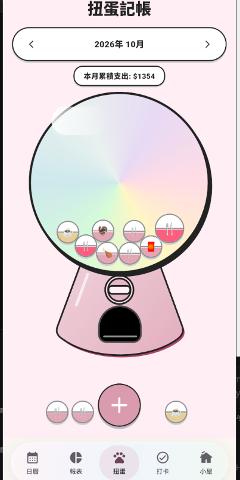
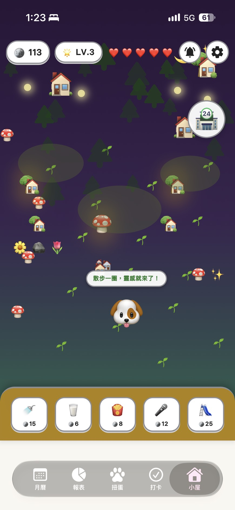
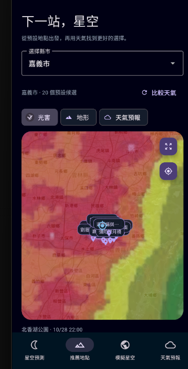
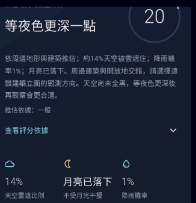

<h1 align="center">Hi, I’m Lynn 👋</h1>

<strong>Mobile Apps · Software Engineering · Spatial Data</strong>

National University of Tainan · Taiwan

我是 Lynn，國立臺南大學數位學習科技學系的學生。
目前作品累積有行動 App 及其他資訊系統，並關注使用者需求以及怎麼記錄、查詢與理解資料。目前的兩個個人作品分別從**記帳習慣**和**觀星預測**出發。

I’m a student developer in Taiwan. I build mobile apps and explore how software, databases, and spatial data can help people make everyday decisions.

### Aspiring Software Engineer & Systems Architect 

> 專注於 **軟體工程、系統重構與維護 (Refactoring & Debugging)**、**資料視覺化 (Data Visualization)** 與 **演算法應用**。具備扎實數理底子與跨領域專案統御經驗。

---

##  核心能力與學術基石 (Core Competencies)

- **核心電腦科學底層 (Core CS Foundations)：**
  - 資料結構 (Data Structures) — **91 分**
  - 電腦圖學 (Computer Graphics) — **98 分**(全系第一名)
  - 線性代數 (Linear Algebra) — **89 分**
  - 視覺化程式設計 (Visual Programming) — **92 分**
  - 管理資訊系統 (MIS) — **92 分**
  - *跨選中：資工系作業系統 (OS)、電機系程式設計、資工資料庫系統*
- **程式語言與開發工具：** C/C++,JavaScript , Python,  HTML5/CSS3, Git / GitHub
- **軟體工程實務：** 狀態管理 (State Management)、Chrome DevTools 斷點除錯、WBS 專案時程管理、

---

## 個人 App 開發專案 · Featured Apps

### 🎰 扭蛋記帳 · Cute Expense

**Flutter · Dart · 行動應用**

**我想解決的問題**｜記帳需要每天做，但紀錄完很容易就關掉。這個 App 讓每筆收支紀錄都能換一顆扭蛋，讓記帳本身更有回饋，也有理由回來看自己的紀錄。

- **記錄與回顧**｜新增、編輯或刪除收支，從月曆查找紀錄，透過週、月、年報表比較消費變化。
- **扭蛋與養成**｜透過手機晃動觸發扭蛋互動，也能餵食寵物與佈置小屋。

**我做了什麼**｜用 Flutter 與 Dart 實作記帳流程，整合收支的新增、編輯與刪除，並讓使用者能從月曆與不同時間範圍的報表回看紀錄。扭蛋和寵物養成則接在記帳流程之後，為每次紀錄提供立即回饋。

*A Flutter expense tracker with calendar views, spending reports, and capsule-toy rewards.*

[扭蛋記帳官方支援](https://github.com/Lynn111955050/gochaexpense-support)

#### 扭蛋記帳實際畫面

<table>
  <tr>
    <th scope="col">扭蛋機</th>
    <th scope="col">寵物小屋</th>
  </tr>
  <tr>
    <td valign="top"></td>
    <td valign="top"></td>
  </tr>
  <tr>
    <td valign="top">查看當月累積支出，每筆記帳以扭蛋呈現。</td>
    <td valign="top">查看寵物等級與愛心，並選擇道具與寵物互動。</td>
  </tr>
</table>

### 🌌 觀星 App · Stargazing Planner

**天氣資料 · 地圖 · 天象資料**

**我想解決的問題**｜同一個晚上，不同地點的天氣條件可能差很多。這個 App 從「今晚去哪裡看星星？」出發，讓使用者從地圖選地點，再查那個位置的天氣與觀星條件。

- **地圖與定位**｜顯示觀星地點，並用 GPS 定位查看目前位置附近的選擇。
- **地點天氣**｜依地點經緯度查詢氣象資料，協助比較不同位置的觀星條件。
- **天象資料**｜用具版本的 JSON 清單管理天象事件、起訖時間與來源，供 App 更新顯示。

**我做了什麼**｜串接定位、地圖、地點座標與氣象查詢，將原本分開的資訊整理到同一個查詢流程。目前持續驗證預報與實際條件的差異。

*A stargazing app project that combines weather, maps, and a maintained sky-event dataset.*

#### App 實際畫面

<table>
  <tr>
    <th scope="col">地圖選點</th>
    <th scope="col">觀星評估</th>
  </tr>
  <tr>
    <td valign="top"></td>
    <td valign="top"></td>
  </tr>
  <tr>
    <td valign="top">從嘉義市的候選地點選點，在光害圖層上查看周邊條件。</td>
    <td valign="top">查看觀星建議，並閱讀天空覆蓋比例、月亮狀態與降雨機率。</td>
  </tr>
</table>

## 團隊作品 · Team Project

### 🤟 Handsonme 手語學習系統

把單字、配對練習和情境對話串成一套互動教材。學習者可以先用單字卡辨認手語，再做配對、翻牌等練習，最後透過語句測驗或情境對話複習。

**我做了什麼**｜製作互動教材，包含單字卡、配對遊戲與情境對話，並且製作一套完整的數位教學系統。

[觀看 Handsonme 展示影片](https://youtu.be/aH45txA8VDU?si=2NbJ82Gj5yX2XEDq)

## 其他作品 · More Projects

- **[校園設備借用](https://github.com/Lynn111955050/campus-equipment-reservation)**｜校園設備借用專案。

## 技術工具 · Technologies

| 領域 | 工具與主題 |
| --- | --- |
| 行動應用 | Flutter · Dart |
| 網頁與資料 | JavaScript · React · Flask · SQL · Firestore |
| 電腦科學 | C/C++ · 資料結構 · 演算法 · 作業系統 |
| 除錯與協作 | Git / GitHub · Chrome DevTools · 狀態管理 |

## 學習與協作 · Experience

- **課程基礎**｜微積分、計算機概論、資料結構、電腦圖學、線性代數。另修習作業系統與資料庫系統。
- **教學協助**｜小幫手、助教：離散數學、電腦圖學
- **協作經驗**｜擔任畢業專題副召集人及系學會副會長及各場合司儀，協助時程追蹤與跨組協調。

##  精選代表專案 (Featured Projects)

###  大二上 - JavaScript 互動遊戲系統除錯與架構維護
- **核心職責：** 系統代碼閱讀、事件機制追蹤、邏輯除錯與渲染效能優化。
- **工程價值：** 展現獨立排錯與底層程式理解能力。

###  上架APP - 智慧決策與數據視覺化系統
- **核心職責：** 全端應用架構規劃、資料視覺化圖表引擎串接、多條件檢索演算法落地。
- **工程價值：** 模組化設計與響應式 UI/UX，善用flutter、dart語法以及 Generative AI 協同開發加速模組迭代與除錯。

---

##  學術成長與抗壓韌性 (Academic Resilience)
-[大一摸索適應期] ────► [重構學習架構] ────► [大二全面爆發：二上總平均分 93 / 系排前五 10%] ────► [二年級總排名：系排六]

---
📫 **聯絡方式 / Contact** a0975572026@gmail.com
- **Location:** Taiwan
